# Zvirkovska_nosql_3 — Граф знань для рекомендаційної системи

Рекомендаційний граф на Neo4j 5.18 (Docker) за датасетом MovieLens 1M: 6 040 користувачів, 3 883 фільми, 18 жанрів, 1 000 209 оцінок.

| Файл | Що в ньому |
|---|---|
| `docker-compose.yml` | локальний запуск Neo4j з плагінами APOC і GDS |
| `convert.py` | конвертація `.dat` → `.csv` у `import/` |
| `check_data.py` | перевірки даних, на які я посилаюсь у відповідях |
| `import/` | CSV для `LOAD CSV` (самі `.dat` не комітяться) |
| `queries/part2_load.cypher` | індекси та завантаження даних |
| `queries/part3.cypher` | 6 запитів частини 3 |
| `queries/part4_supernodes.cypher` | пошук супервузлів і стратегія |
| `sql_compare.py` | SQL-версії запитів у SQLite для частини 6 |
| `screenshots/` | скриншоти результатів |

Частина 5 (GDS) — необов'язкова, я її не виконувала.

## Підготовка даних — конвертація `.dat` → `.csv`

Датасет [MovieLens 1M](https://grouplens.org/datasets/movielens/1m/) розпакований у `ml-1m/` (не комітиться). Скрипт `convert.py` переписує три файли з роздільника `::` і кодування Latin-1 у CSV з роздільником `,` і UTF-8 та кладе їх у `import/`, звідки їх читає Neo4j.

Вивід `convert.py`:

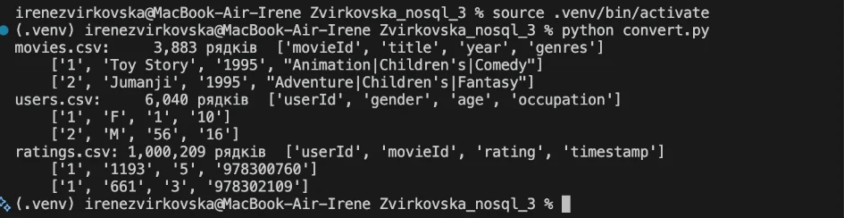

Кількість рядків збігається з описом датасету: 3 883 фільми, 6 040 користувачів, 1 000 209 оцінок.

### Зміни у скрипті `convert.py` відносно шаблону

- **Шляхи.** Шаблон читав `movies.dat` з кореня проєкту, а архів розпаковується в папку `ml-1m/`, тому скрипт читає `ml-1m/*.dat`.
- **Рік окремою колонкою.** У схемі графа фільм має властивість `year`, а в шаблоні рік залишався всередині назви: `Toy Story (1995)`. Я відділяю його в Python регулярним виразом, і в `movies.csv` виходять колонки `title = "Toy Story"` і `year = 1995`. Так рік можна одразу завантажити як число, і в Cypher не доводиться розбирати рядок.
- **Нестандартні назви.** Я перевірила правило на всіх 3 883 назвах:
  - у деяких назвах дві пари дужок, наприклад `Seven (Se7en) (1995)`, тому рік береться лише з останніх дужок;
  - в одній назві перед роком немає пробілу: `Associate, The (L'Associe)(1982)`. З правилом із шаблону (з пробілом) цей фільм залишився б без року, тому пробіл необов'язковий. У README датасету попереджають, що фільми вводили вручну і можливі неточності; це якраз такий випадок;
  - якщо в назві не знайдеться року, скрипт зупиняється з помилкою, а не пише порожнє значення.
- **Одна функція замість трьох однакових блоків.** Відрізняється лише обробка колонок (`movie`, `user`, `rating`), а читання, запис і підсумковий вивід спільні.
- **Перевірка результату.** Скрипт друкує кількість рядків і перші два рядки кожного файлу.

Назви з комами (`"American President, The"`) `csv.writer` бере в лапки, тому `LOAD CSV` прочитає їх як одне поле. Кодування Latin-1 тут справді важливе: у 50 назвах є символи поза ASCII (`Misérables, Les`, `Café au Lait`, `Á köldum klaka`). Якщо прочитати `movies.dat` як UTF-8, усі 50 назв виходять зі зламаними символами (`Mis�rables`). `convert.py` читає файли в Latin-1 і пише в UTF-8, тому в CSV вони правильні.

### Перевірки даних — `check_data.py`

Перевірки, на які я спираюсь у відповідях нижче:

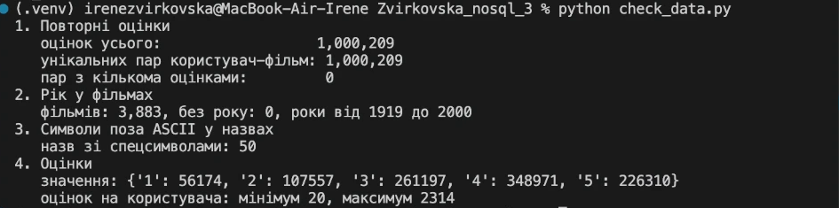

- жоден користувач не оцінив той самий фільм двічі: 1 000 209 оцінок = 1 000 209 унікальних пар користувач–фільм;
- рік знайшовся в усіх 3 883 фільмах (1919–2000);
- 50 назв містять символи поза ASCII;
- оцінки лише цілі від 1 до 5; кожен користувач має від 20 до 2 314 оцінок.

## Розгортання Neo4j (Docker)

Я обрала варіант A — локальний Neo4j 5.18 Community у Docker (`docker-compose.yml`). AuraDB Free не підходить: обмеження ~200 MB змусило б брати лише частину оцінок, а повний датасет — 1 000 209 ребер `RATED`.

Відмінності `docker-compose.yml` від шаблону:
- відновлені відступи YAML (у тексті завдання вони загубились);
- додано `NEO4J_dbms_memory_pagecache_size: "512m"`: Docker на моєму MacBook має ~4 GB пам'яті, і з heap 2 GB кеш сторінок краще обмежити явно.

Запуск `docker compose up -d` і встановлення плагінів APOC та GDS:

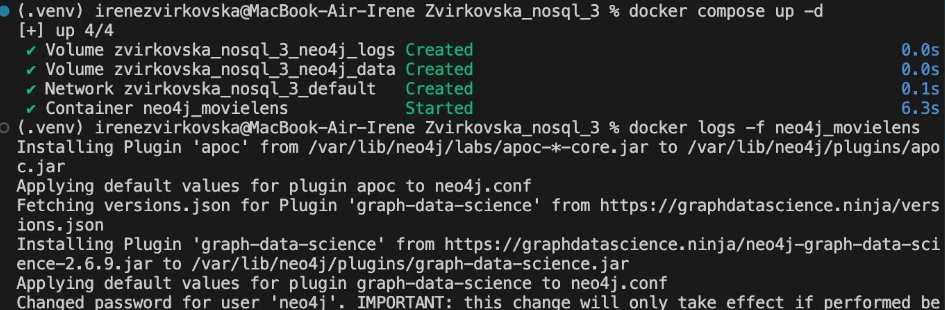

Перевірка плагінів у `cypher-shell`: `RETURN apoc.version(), gds.version()` → APOC `5.18.0`, GDS `2.6.9`.

Neo4j Browser на http://localhost:7474, підключення під користувачем `neo4j`:


У логах старту Neo4j попереджає, що налаштування пам'яті з шаблону (`dbms.memory.heap.*`, `dbms.memory.pagecache.size`) застарілі і в Neo4j 5 називаються `server.memory.*`. Вони все одно застосовуються, тому я залишила назви як у шаблоні.

## Частина 1 — Проєктування схеми

```
(:User {userId, gender, age, occupation})
        │
        │ [:RATED {rating, timestamp}]
        ▼
(:Movie {movieId, title, year})
        │
        │ [:HAS_GENRE]
        ▼
(:Genre {name})
```

**1. Які сутності стали вузлами, а які — ребрами? Чому?**

Головні вузли — `User` і `Movie`: рекомендації будуються саме переходами між користувачами і фільмами. Жанр я теж зробила вузлом `Genre` (чому — у питанні 3).

Оцінка — це ребро `RATED` з властивостями `rating` і `timestamp`, бо вона не існує сама по собі, а завжди пов'язує конкретного користувача з конкретним фільмом.

Стать, вік і професія користувача та рік фільму — властивості. Це описи, за якими зручно фільтрувати, але в жодному запиті завдання ми не переходимо «через професію» чи «через рік», тому окремі вузли тут нічого не дали б.

Напрямок ребер: `User → Movie` (користувач оцінює фільм) і `Movie → Genre` (фільм належить до жанру).

**2. Оцінка — це ребро `(User)-[:RATED]->(Movie)` чи окремий вузол `(Rating)`?**

Я обрала ребро `RATED` з властивостями `rating` і `timestamp`.

Головна причина — довжина шляхів. Рекомендація «я → фільм → людина зі схожим смаком → її фільм» з ребром займає 3 кроки. Якби оцінка була вузлом, `(User)-[:GAVE]->(Rating)-[:FOR]->(Movie)`, кожен перехід через оцінку став би подвійним, і той самий шлях займав би 6 кроків. Запити стали б довшими й повільнішими, а саме заради таких переходів я і будую граф. Крім того, з вузлами замість 1 млн ребер було б 1 млн додаткових вузлів і 2 млн ребер.

Ребро тут підходить і за змістом: оцінка не існує сама по собі, вона завжди пов'язує рівно одного користувача з одним фільмом. Я перевірила дані (`check_data.py`, перевірка 1): жоден користувач не оцінив той самий фільм двічі, тобто на кожну пару користувач–фільм припадає рівно одна оцінка.

Але в ребра є мінуси, і в іншому датасеті я б обрала вузол:
- до ребра не можна нічого приєднати. Якби в оцінки був текстовий відгук, лайки від інших людей чи зв'язок із сесією перегляду, без вузла `Rating` не обійтися;
- якщо людина переоцінює фільм, з вузлами легко зберегти всю історію оцінок, а з ребром доведеться або перезаписувати оцінку, або тримати кілька паралельних ребер між тими самими вузлами;
- шукати по самих оцінках (наприклад, «всі оцінки за грудень 2000-го») зручніше, коли це вузли з індексом на `timestamp`.

У MovieLens оцінка — це лише число і час, без відгуків та історії, тому ці плюси вузла мені не потрібні, а короткі шляхи для рекомендацій важливіші.

**3. Чому жанри фільму вигідніше зберігати як окремі вузли `Genre`, а не як список у властивості `Movie`?**

Я порівнювала два варіанти:

```
Список:  (:Movie {title: "Toy Story", genres: ["Animation", "Children's", "Comedy"]})
Вузол:   (:Movie {title: "Toy Story"})-[:HAS_GENRE]->(:Genre {name: "Comedy"})
```

Цифри, на які я спираюсь, — з `check_data.py` (перевірка 5): 18 жанрів, 6 408 зв'язків фільм–жанр, майже половина фільмів (1 858 з 3 883) має більше одного жанру.

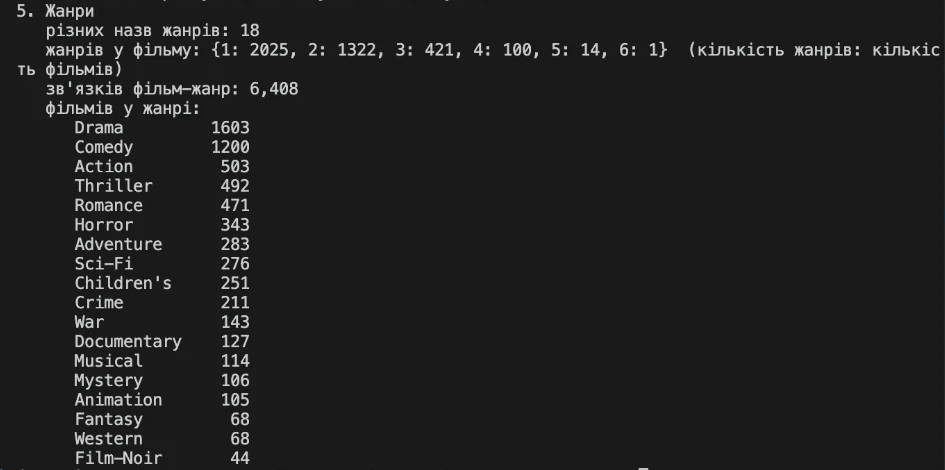

Чому вузли вигідніші:

- **Пошук за жанром.** Якщо жанри — список, то щоб знайти всі трилери, Neo4j мусить відкрити кожен з 3 883 фільмів і перевірити його список. Якщо жанр — вузол, Neo4j знаходить один вузол `Thriller` за індексом і просто йде по його 492 ребрах до фільмів.
- **Жанр як міст між фільмами.** Через вузол жанру граф з'єднує фільми між собою: «знайди фільми того ж жанру, що й фільм, який мені сподобався» — це звичайний перехід `Movie → Genre → Movie`. Зі списком такого переходу немає, лише порівняння рядків.
- **Немає дублів і помилок.** Вузол `Comedy` існує в базі один раз. У списках кожен фільм зберігає свою копію рядка, і одна помилка (`"comedy"`, `"Comedy "`) тихо створила б «новий» жанр. Зараз у даних рівно 18 назв, як у документації, але з вузлами це гарантує сама схема.
- **Простіші запити по жанрах.** Запит 4 (жанри зі стабільно високими оцінками) з вузлами — це звичайне групування по `Genre`. Зі списками довелося б для кожного фільму розгортати список через `UNWIND`.
- **Метадані жанру.** Якщо знадобиться опис жанру, переклад назви чи ієрархія (`Film-Noir` як піджанр `Crime`), це просто властивості чи ребра вузла `Genre`. У списку рядків їх нікуди додати.

Мінус: жанрів лише 18, а фільмів у них багато, тому найбільші жанри стають супервузлами. `Drama` пов'язаний з 1 603 фільмами (41% усіх), `Comedy` — з 1 200. Запит, що проходить через такий вузол, перебирає тисячі ребер. Детальніше — у частині 4.

## Частина 2 — Завантаження даних

Усі запити — у `queries/part2_load.cypher`. Я виконувала їх по черзі в Neo4j Browser. CSV лежать у `import/`, яка підключена в контейнер, тому шлях до файлів — `file:///users.csv`. `LOAD CSV` читає всі значення як рядки, тому числа я перетворюю через `toInteger()`: інакше `rating >= 4` у частині 3 порівнював би рядки, а не числа.

### Крок 1. Обмеження унікальності (індекси)

```cypher
CREATE CONSTRAINT user_id IF NOT EXISTS
FOR (u:User) REQUIRE u.userId IS UNIQUE;
CREATE CONSTRAINT movie_id IF NOT EXISTS
FOR (m:Movie) REQUIRE m.movieId IS UNIQUE;
CREATE CONSTRAINT genre_name IF NOT EXISTS
FOR (g:Genre) REQUIRE g.name IS UNIQUE;
```

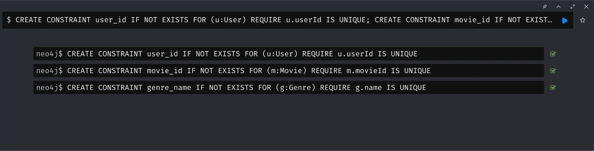

Обмеження унікальності в Neo4j автоматично створює індекс на цій властивості і, крім того, не дає з'явитися двом вузлам з однаковим ID. Тобто захист від дублів закладений у саму базу, а не лише в запити.

Я створила обмеження перед завантаженням вузлів, а не лише перед ребрами, як у шаблоні: `MERGE` спочатку шукає, чи існує вузол, і без індексу кожен такий пошук перебирав би всі вузли з цим лейблом. `IF NOT EXISTS` дозволяє запускати скрипт повторно без помилки.

### Крок 2. Вузли `User`

```cypher
LOAD CSV WITH HEADERS FROM 'file:///users.csv' AS row
MERGE (u:User {userId: toInteger(row.userId)})
SET u.gender     = row.gender,
    u.age        = toInteger(row.age),
    u.occupation = toInteger(row.occupation);
```


`MERGE` іде лише по ключу `userId`, а решта властивостей задається через `SET`. Якби всі властивості були всередині `MERGE`, то при повторному запуску з іншим значенням (наприклад, виправленим віком) Neo4j не знайшов би вузол з таким набором властивостей і спробував би створити новий, а обмеження видало б помилку. Створено 6 040 вузлів і 24 160 властивостей (6 040 × 4).

### Крок 3. Вузли `Movie`, `Genre` і ребра `HAS_GENRE`

```cypher
LOAD CSV WITH HEADERS FROM 'file:///movies.csv' AS row
MERGE (m:Movie {movieId: toInteger(row.movieId)})
SET m.title = row.title,
    m.year  = toInteger(row.year)
WITH m, row
UNWIND split(row.genres, '|') AS genreName
MERGE (g:Genre {name: genreName})
MERGE (m)-[:HAS_GENRE]->(g);
```


Жанри в CSV — рядок `Animation|Children's|Comedy`. `split()` перетворює його на список, `UNWIND` робить з кожного елемента окремий рядок, і для кожного жанру `MERGE` знаходить існуючий вузол `Genre` або створює новий. Тому вузлів жанрів рівно 18, хоча жанр згадується 6 408 разів. Результат: 3 901 вузол (3 883 фільми + 18 жанрів), 11 667 властивостей (3 883 × 3 + 18) і 6 408 ребер `HAS_GENRE`.

### Крок 4. Ребра `RATED` батчами

```cypher
CALL apoc.periodic.iterate(
  "LOAD CSV WITH HEADERS FROM 'file:///ratings.csv' AS row RETURN row",
  "MATCH (u:User  {userId:  toInteger(row.userId)})
   MATCH (m:Movie {movieId: toInteger(row.movieId)})
   MERGE (u)-[r:RATED]->(m)
   SET r.rating    = toInteger(row.rating),
       r.timestamp = toInteger(row.timestamp)",
  {batchSize: 10000, parallel: false}
)
YIELD batches, total, timeTaken, committedOperations, failedOperations, errorMessages
RETURN batches, total, timeTaken, committedOperations, failedOperations, errorMessages;
```

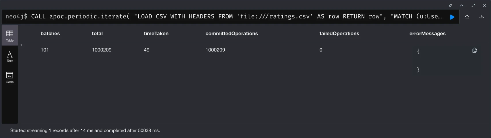

Мільйон ребер в одній транзакції Neo4j тримав би в пам'яті до самого коміту, і з heap 2 GB транзакція могла б впасти. `apoc.periodic.iterate` бере два запити: перший лише читає рядки CSV, другий виконується для кожного рядка, а APOC комітить кожні 10 000 рядків окремою транзакцією.

- Вузли на цей момент уже існують, тому в тілі `MATCH` (пошук за індексом з кроку 1), а не `MERGE` для вузлів.
- Для самого ребра — `MERGE`, щоб повторний запуск не створив другу оцінку тієї ж пари.
- `parallel: false`: у популярних фільмів тисячі оцінок у різних батчах, і паралельні потоки чекали б один одного на блокуванні того самого вузла або впали б з deadlock.

Результат: 101 батч, 1 000 209 операцій, 0 помилок, ~50 секунд.

### Крок 5. Перевірка

```cypher
CALL { MATCH (u:User)  RETURN count(u) AS users }
CALL { MATCH (m:Movie) RETURN count(m) AS movies }
CALL { MATCH (g:Genre) RETURN count(g) AS genres }
CALL { MATCH ()-[r:RATED]->()     RETURN count(r) AS ratings }
CALL { MATCH ()-[h:HAS_GENRE]->() RETURN count(h) AS hasGenre }
RETURN users, movies, genres, ratings, hasGenre;
```


Три окремі запити з шаблону (`users`, `movies`, `ratings`) я об'єднала в один через підзапити `CALL { }` і додала жанри та `HAS_GENRE`. Усі числа збігаються з `check_data.py`: 6 040 / 3 883 / 18 / 1 000 209 / 6 408.

Перевірка дублів — пари користувач–фільм, між якими більше одного ребра `RATED`:

```cypher
MATCH (u:User)-[r:RATED]->(m:Movie)
WITH u, m, count(r) AS n
WHERE n > 1
RETURN count(*) AS duplicatePairs;
```

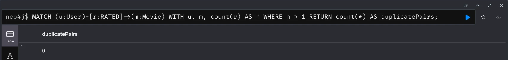

Обмеження, які існують у базі:

```cypher
SHOW CONSTRAINTS YIELD name, labelsOrTypes, properties, type;
```

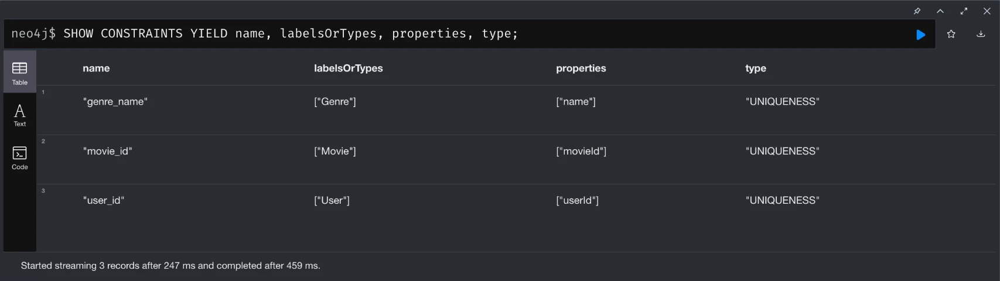

Схема графа, як її бачить Neo4j (`CALL db.schema.visualization()`), збігається з ASCII-схемою з частини 1:

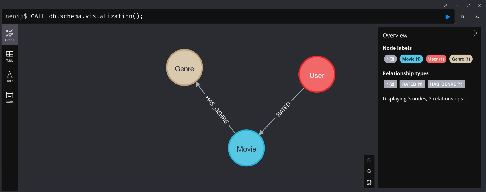

## Частина 3 — Запити різної складності

Усі запити — у `queries/part3.cypher`. На скриншотах — перші рядки результату, повна кількість рядків видна внизу кожного скриншоту.

### Запит 1. Фільми жанру Thriller із середнім рейтингом вище 4.0

```cypher
MATCH (:Genre {name: 'Thriller'})<-[:HAS_GENRE]-(m:Movie)<-[r:RATED]-(:User)
WITH m, avg(r.rating) AS avgRating, count(r) AS ratings
WHERE avgRating > 4.0
RETURN m.title AS title, m.year AS year, round(avgRating, 2) AS avgRating, ratings
ORDER BY avgRating DESC, ratings DESC;
```

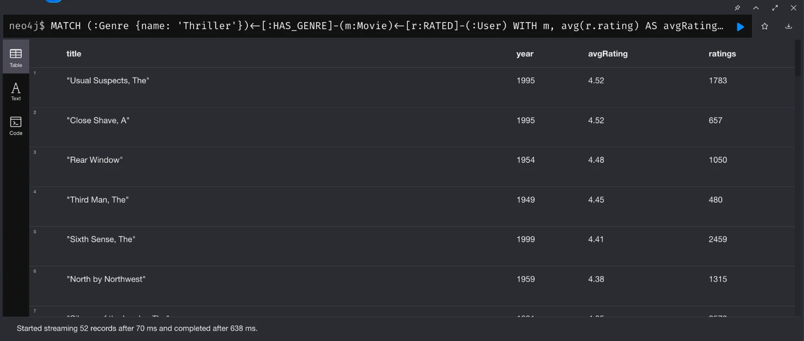

Запит починається з одного вузла `Genre {name: 'Thriller'}` (знаходиться за індексом з частини 2) і йде по ребрах `HAS_GENRE` лише до 492 трилерів, а від них — до їхніх оцінок. `WITH` групує оцінки по фільму і рахує середнє, а `WHERE` після `WITH` залишає тільки фільми із середнім > 4.0 (аналог `HAVING` у SQL). Кількість оцінок `ratings` я виводжу, щоб перевірити, що середнє не пораховане з 2–3 оцінок: у всіх 52 знайдених фільмів не менше 43 оцінок, тож окремий поріг за кількістю тут не потрібен.

### Запит 2. Користувачі, які поставили оцінку 5 більш ніж 50 фільмам

```cypher
MATCH (u:User)-[r:RATED]->(:Movie)
WHERE r.rating = 5
WITH u, count(r) AS fives
WHERE fives > 50
RETURN u.userId AS userId, u.gender AS gender, u.age AS age,
       fives, COUNT { (u)-[:RATED]->() } AS totalRatings
ORDER BY fives DESC;
```

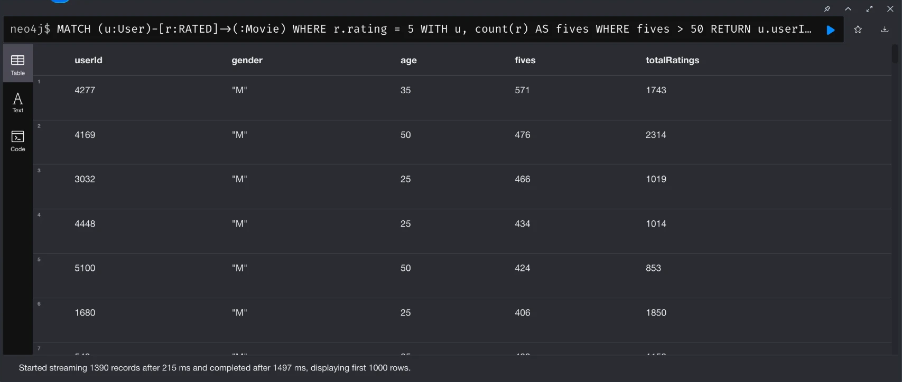

Перший `WHERE` фільтрує ребра ще до підрахунку (беремо тільки п'ятірки), другий — вже пораховані значення. `COUNT { }` — підзапит, який для кожного знайденого користувача рахує всі його оцінки, щоб було видно частку п'ятірок. Таких користувачів 1 390. Лідер (userId 4277) поставив 571 п'ятірку з 1 743 оцінок, а найактивніший користувач датасету (4169, 2 314 оцінок) — на другому місці.

### Запит 3. Фільми, які обидва користувачі (1 і 2) оцінили на ≥ 4

```cypher
MATCH (u1:User {userId: 1})-[r1:RATED]->(m:Movie)<-[r2:RATED]-(u2:User {userId: 2})
WHERE r1.rating >= 4 AND r2.rating >= 4
RETURN m.title AS title, m.year AS year, r1.rating AS user1Rating, r2.rating AS user2Rating
ORDER BY title;
```

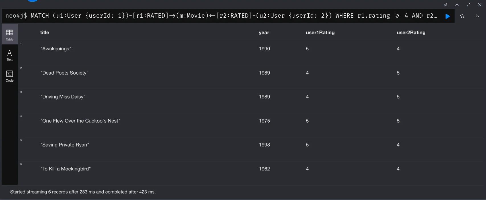

Один шаблон описує «користувач 1 → фільм ← користувач 2»: фільм, оцінений обома, — це спільний сусід двох вузлів. Обидва користувачі знаходяться за індексом, а далі Neo4j перебирає лише 53 оцінки першого користувача. Результат — 6 фільмів; спільних фільмів у них загалом 7, і лише один з них хтось оцінив нижче 4.

### Запит 4. Жанри, чиї фільми стабільно отримують високі оцінки

```cypher
MATCH (g:Genre)<-[:HAS_GENRE]-(:Movie)<-[r:RATED]-(:User)
RETURN g.name AS genre,
       round(avg(r.rating), 2) AS avgRating,
       round(stDev(r.rating), 2) AS stdDev,
       round(100.0 * sum(CASE WHEN r.rating >= 4 THEN 1 ELSE 0 END) / count(r), 1) AS pctHigh,
       count(r) AS ratings
ORDER BY avgRating DESC;
```

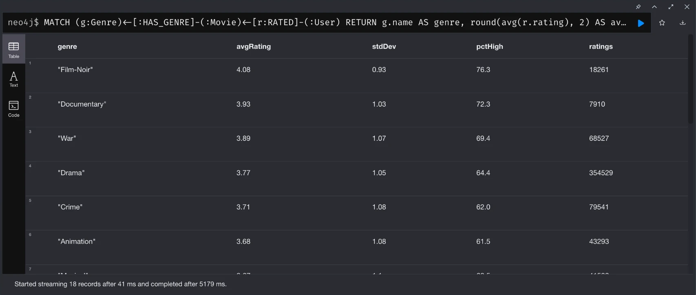

Крім середнього рейтингу і кількості оцінок, які просить завдання, я додала дві метрики для слова «стабільно»: `stdDev` — стандартне відхилення оцінок (чим менше, тим однорідніші оцінки), і `pctHigh` — частка оцінок 4–5. Агрегація без `WITH` групує по `g.name` автоматично: у Cypher усі неагреговані колонки в `RETURN` — це ключі групування.

На першому місці Film-Noir: найвищий середній рейтинг (4.08), найменший розкид (0.93) і 76% високих оцінок, тобто він найстабільніший. Наприкінці — Horror: 3.22, найбільший розкид (1.23) і менше половини високих оцінок. Оцінка одного фільму рахується в кожному з його жанрів, тому сума `ratings` по жанрах більша за 1 000 209.

### Запит 5. Рекомендація «користувачі зі схожими смаками також дивилися»

```cypher
MATCH (me:User {userId: 1})-[r1:RATED]->(m:Movie)<-[r2:RATED]-(other:User)
WHERE r1.rating >= 4 AND r2.rating >= 4
WITH me, other, count(m) AS commonLiked
ORDER BY commonLiked DESC
LIMIT 50
MATCH (other)-[r:RATED]->(rec:Movie)
WHERE r.rating >= 4 AND NOT (me)-[:RATED]->(rec)
RETURN rec.title AS title, rec.year AS year,
       count(other) AS recommendedBy, round(avg(r.rating), 2) AS avgRating
ORDER BY recommendedBy DESC, avgRating DESC
LIMIT 10;
```

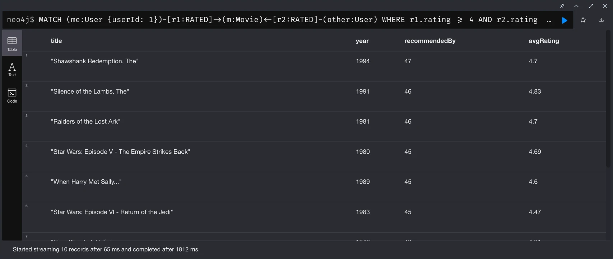

Запит працює у три кроки:
1. **Схожі користувачі** — ті, хто теж оцінив на 4–5 фільми, які сподобались користувачу 1. Схожість — кількість таких спільних улюблених фільмів (`commonLiked`); беру 50 найсхожіших.
2. **Кандидати** — фільми, які ці 50 людей оцінили на 4–5. `NOT (me)-[:RATED]->(rec)` відкидає все, що користувач 1 уже оцінював (паттерн у `WHERE` перевіряє, чи існує таке ребро).
3. **Ранжування** — за тим, скільки схожих користувачів «голосує» за фільм, а при рівності — за їхньою середньою оцінкою.

Обмеження цього підходу: схожість — це просто кількість спільних фільмів, тому найсхожішими виходять користувачі, які оцінили дуже багато фільмів, а рекомендації — найпопулярніші фільми (Shawshank Redemption, Star Wars). Точніше було б нормалізувати схожість на кількість оцінок кожного (наприклад, коефіцієнт Жаккара) — це вже ближче до алгоритмів GDS з частини 5.

### Запит 6. Найкоротший ланцюжок між двома користувачами через спільні фільми

```cypher
UNWIND [[1, 2], [1, 46]] AS pair
MATCH (a:User {userId: pair[0]}), (b:User {userId: pair[1]})
MATCH p = shortestPath((a)-[:RATED*..10]-(b))
RETURN pair[0] AS fromUser, pair[1] AS toUser, length(p) AS pathLength,
       [n IN nodes(p) | coalesce(n.title, 'User ' + toString(n.userId))] AS path;
```

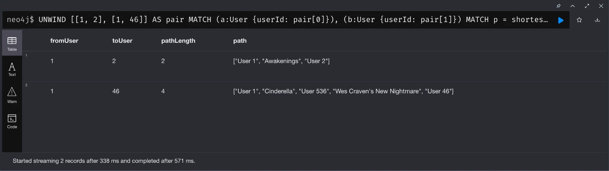

`shortestPath` шукає найкоротший шлях по ребрах `RATED` довжиною до 10 кроків. Напрямок ребер не вказаний (`-[...]-` без стрілки), бо шлях чергується: користувач → фільм ← користувач → фільм ← … `UNWIND` дозволяє перевірити кілька пар одним запитом. Шлях я виводжу як список назв: для фільму це `title`, для користувача — `'User ' + userId` (`coalesce` бере першу непорожню властивість).

- Пара 1 і 2 має спільні фільми, тому шлях довжини 2: `User 1 → Awakenings ← User 2`.
- Пару 1 і 46 я знайшла спеціально: у них немає жодного спільного фільму. Шлях — довжини 4, через користувача 536, який оцінив і фільм користувача 1 (Cinderella), і фільм користувача 46 (Wes Craven's New Nightmare).

Вкладка Warn у Neo4j Browser — попередження про декартовий добуток у `MATCH (a), (b)`: два незв'язані шаблони. Тут це очікувано, бо кожен шаблон повертає рівно один вузол.

Перевірка для питання про шляхи довжини 6 — з найактивнішим користувачем (4169, 2 314 оцінок) хоча б один спільний фільм має кожен з 6 039 інших користувачів:

```cypher
MATCH (hub:User {userId: 4169})-[:RATED]->(:Movie)<-[:RATED]-(u:User)
RETURN count(DISTINCT u) AS usersSharingAMovieWithHub;
```

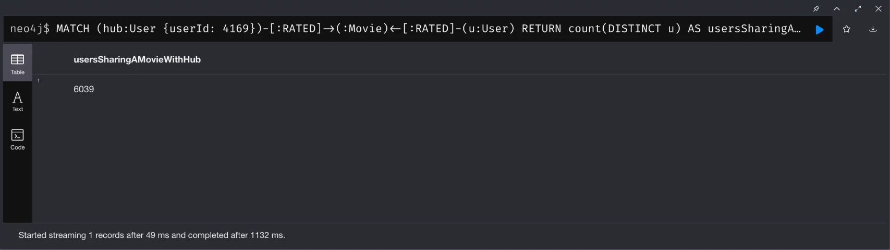

**Що означає довжина шляху? Як інтерпретувати шлях довжини 4? Довжини 6?**

Один хоп — це один крок по ребру `RATED`, тобто від користувача до фільму або від фільму до користувача. Тому між двома користувачами шлях завжди парної довжини: користувач → фільм → користувач.

- **Довжина 2** — двоє людей оцінили один і той самий фільм. У моєму прикладі користувачі 1 і 2 обидва оцінили «Awakenings». Це найближчий зв'язок, який може бути між двома користувачами.
- **Довжина 4** — спільного фільму немає, але є посередник: третя людина, яка оцінила і фільм першого, і фільм другого. У прикладі користувачі 1 і 46 не мають жодного спільного фільму, і їх пов'язує користувач 536 через «Cinderella» та «Wes Craven's New Nightmare». Таких пар без спільних фільмів у датасеті 4,2% (765 270 з 18 237 780, `check_data.py`, перевірка 6), тобто для решти 95,8% пар шлях — 2.
- **Довжина 6** означала б, що навіть одного посередника не знайшлось і потрібно двоє. Але в цьому датасеті такого шляху немає взагалі. Я перевірила це запитом 6б: найактивніший користувач (4169, 2 314 оцінок) має спільний фільм з кожним з інших 6 039 користувачів. Тож будь-яких двох людей можна з'єднати через нього шляхом не довшим за 4.

Чим довший шлях, тим менше спільного у смаках двох людей. Для рекомендацій корисні короткі шляхи: якщо між людьми шлях 2, у них є спільні фільми, а шлях 4 майже нічого не каже про схожість, бо такий зв'язок майже завжди проходить через дуже активного користувача, який оцінив усе підряд. Це той самий ефект, що й у запиті 5: активні користувачі «зшивають» увесь граф і виходять «схожими» на всіх. Детальніше про такі вузли — у частині 4.

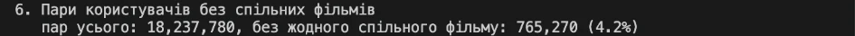

## Частина 4 — Виявлення супервузлів

Усі запити — у `queries/part4_supernodes.cypher`.

### Крок 1. Розподіл кількості ребер за типом вузла

```cypher
MATCH (n)
WITH labels(n)[0] AS label, COUNT { (n)--() } AS degree
RETURN label, count(*) AS nodes, round(avg(degree), 1) AS avgDegree,
       percentileDisc(degree, 0.5) AS median, percentileDisc(degree, 0.99) AS p99,
       max(degree) AS maxDegree
ORDER BY maxDegree DESC;
```

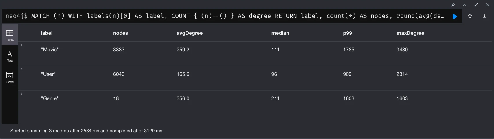

`COUNT { (n)--() }` — ступінь вузла, тобто кількість його ребер у будь-якому напрямку. Щоб сказати, що ребер «аномально багато», треба знати, скільки їх зазвичай, тому я порівнюю медіану, 99-й перцентиль і максимум для кожного типу вузла. Середнє тут погано описує «типовий» вузол: його тягнуть угору кілька дуже великих вузлів (у фільмів середнє 259, а медіана — 111).

### Крок 2. Топ-15 вузлів за кількістю ребер

```cypher
MATCH (n)
WITH n, COUNT { (n)--() } AS degree
ORDER BY degree DESC
LIMIT 15
RETURN labels(n)[0] AS label, coalesce(n.title, n.name, 'User ' + toString(n.userId)) AS node, degree;
```

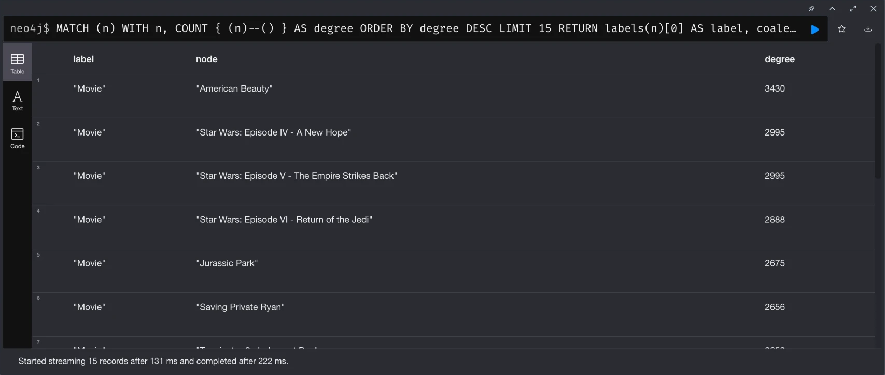

`coalesce` виводить назву фільму, назву жанру або ID користувача — залежно від того, яка властивість є у вузла. Усі 15 найбільших вузлів — популярні фільми. У ступінь фільму входять і 1–3 ребра `HAS_GENRE`, тому в American Beauty 3 430 = 3 428 оцінок + 2 жанри.

### Крок 3. Жанрові вузли

```cypher
MATCH (g:Genre)
CALL {
  WITH g
  MATCH (g)<-[:HAS_GENRE]-(m:Movie)
  RETURN count(m) AS movies, sum(COUNT { (m)<-[:RATED]-() }) AS ratingsBehind
}
RETURN g.name AS genre, movies, ratingsBehind
ORDER BY movies DESC;
```

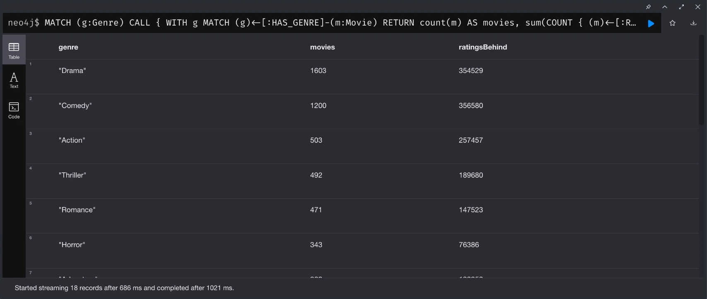

Для кожного жанру підзапит `CALL { }` рахує його власні ребра (фільми) і скільки оцінок стоїть за цими фільмами — тобто скільки ребер `RATED` зачепить будь-який запит, що йде «через жанр до оцінок».

### Крок 4. Той самий запит через супервузол і через звичайний фільм

```cypher
PROFILE
MATCH (:Movie {movieId: 2858})<-[:RATED]-(:User)-[:RATED]->(other:Movie)
RETURN count(DISTINCT other) AS reachableMovies, count(*) AS pathsVisited;
```

Запит «які фільми оцінювали ті, хто оцінив цей фільм» — основа рекомендацій із запиту 5. Я запускала його з `PROFILE`: Neo4j показує план виконання і скільки разів звертався до бази (db hits) на кожному кроці. Порівнюю American Beauty (movieId 2858, 3 428 оцінок — найбільший вузол) і Nights of Cabiria (movieId 2351, 111 оцінок — рівно медіана для фільмів).

| American Beauty (супервузол) | Nights of Cabiria (типовий фільм) |
|---|---|
| 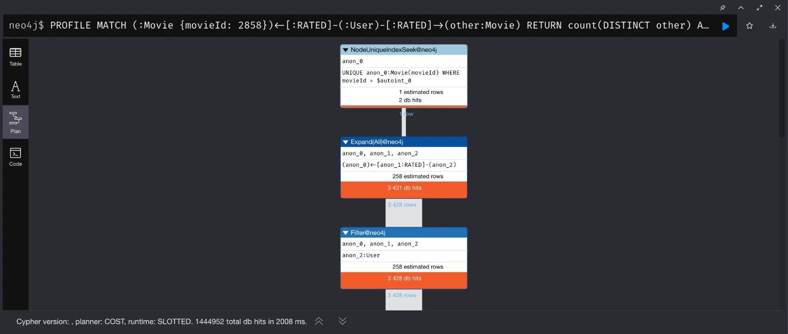 | 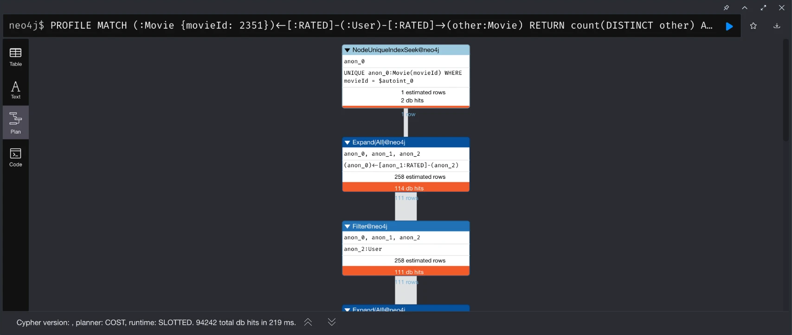 |

### Крок 5. Те саме для жанрів: Drama і Film-Noir

```cypher
PROFILE
MATCH (:Genre {name: 'Drama'})<-[:HAS_GENRE]-(:Movie)<-[r:RATED]-(:User)
RETURN round(avg(r.rating), 2) AS avgRating, count(r) AS ratings;
```

| Drama | Film-Noir |
|---|---|
| 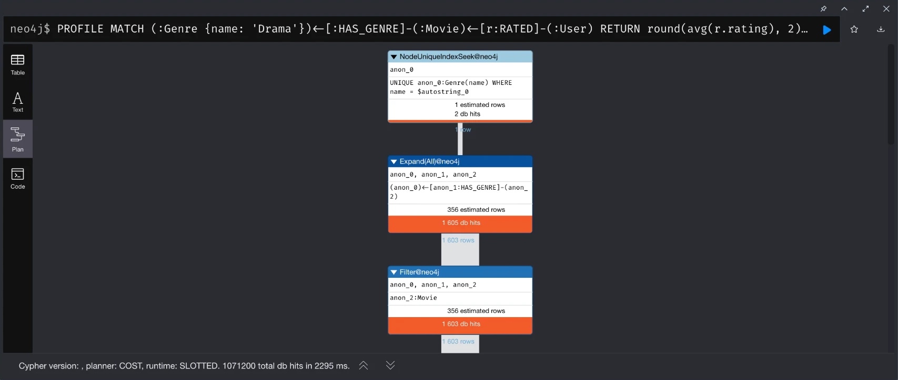 | 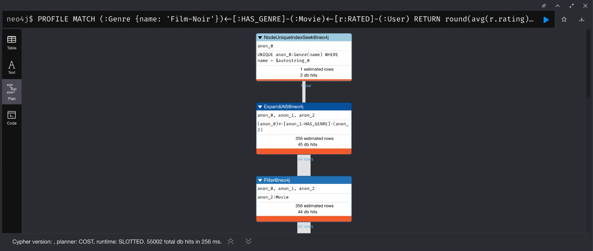 |

### Підсумок вимірювань

| Запит | Ребер у стартового вузла | db hits | Час |
|---|---|---|---|
| через American Beauty | 3 428 | 1 444 952 | 2 008 ms |
| через Nights of Cabiria | 111 | 94 242 | 219 ms |
| через Drama | 1 603 фільми → 354 529 оцінок | 1 071 200 | 2 295 ms |
| через Film-Noir | 44 фільми → 18 261 оцінка | 55 002 | 256 ms |

В обох випадках перший крок однаковий: `NodeUniqueIndexSeek` — пошук стартового вузла за індексом, 2 db hits. Уся різниця виникає далі, на кроках `Expand`, де Neo4j проходить по ребрах.

### Відповіді на питання

**1. Які вузли виявилися супервузлами? Скільки у них зв'язків?**

Супервузли в цьому графі — популярні фільми. У типового фільму 111 оцінок (медіана), а в American Beauty — 3 428, тобто в 31 раз більше. За ним ідуть три частини Star Wars (2 995, 2 995, 2 888), Jurassic Park (2 675), Saving Private Ryan (2 656), Terminator 2, The Matrix — усі 15 найбільших вузлів графа є фільмами з 2 400+ оцінками. Навіть 99-й перцентиль у фільмів (1 785) удвічі менший за максимум.

Серед користувачів теж є «важкі» вузли: користувач 4169 оцінив 2 314 фільмів при медіані 96. Саме він пов'язує між собою всіх користувачів (частина 3, запит 6б).

Жанри — особливий випадок. Власних ребер у них небагато: Drama має 1 603, Comedy — 1 200, а це менше, ніж у популярного фільму. Але жанр стоїть на вході до сотень тисяч оцінок: через Drama проходить 354 529 оцінок, через Comedy — 356 580, тобто кожен з них — третина всіх оцінок датасету. Тому жанри — супервузли не за власною кількістю ребер, а за тим, скільки даних «за ними» зачіпає запит.

**2. Чому запит через супервузол працює повільніше, ніж через звичайний вузол з тими самими індексами?**

Індекс допомагає тільки знайти стартовий вузол. На скриншотах `PROFILE` цей крок коштує 2 db hits і для American Beauty, і для Nights of Cabiria. Далі індекс уже не працює: Neo4j іде від вузла по його ребрах і мусить прочитати кожне з них. У American Beauty це 3 428 ребер, а в Cabiria — 111.

На другому кроці різниця множиться: кожен з 3 428 глядачів American Beauty має свої сотні оцінок, і запит проходить 714 252 шляхи (для Cabiria — 46 845). У результаті American Beauty — 1,44 млн db hits і ~2 с, Cabiria — 94 тис. db hits і ~0,2 с, тобто в 15 разів більше роботи і в 9 разів довше. Для жанрів так само: через Drama — 1,07 млн db hits і 2,3 с, через Film-Noir — 55 тис. і 0,26 с.

Крім того, фільтр за властивістю ребра (наприклад, `rating >= 4`) не скорочує перебір: щоб перевірити оцінку, Neo4j однаково читає кожне ребро. А для `count(DISTINCT ...)` потрібно тримати в пам'яті всі знайдені вузли.

І при цьому супервузол майже не дає нової інформації: через American Beauty досяжні 3 659 фільмів, через Cabiria — 3 393, тобто майже ті самі фільми. Популярний фільм пов'язаний з усіма, тому він «зшиває» граф, але мало що каже про смаки конкретної людини.

**3. Яку стратегію з лекцій я б застосувала для цього датасету? Що робити з жанровими вузлами?**

Для жанрів я обрала б попередньо пораховані агрегати і перевірила це на практиці (крок 6). Більшість запитів через жанр не потребує окремих оцінок — їм потрібна статистика: середній рейтинг і кількість оцінок. Тому я один раз записала кожному фільму властивості `ratingCount` і `avgRating`:

```cypher
MATCH (m:Movie)
CALL { WITH m MATCH (m)<-[r:RATED]-() RETURN count(r) AS n, avg(r.rating) AS a }
SET m.ratingCount = n, m.avgRating = a;
```

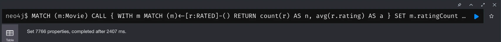

Після цього середній рейтинг Drama рахується як зважене середнє по 1 603 фільмах, без жодного ребра `RATED`:

```cypher
PROFILE
MATCH (:Genre {name: 'Drama'})<-[:HAS_GENRE]-(m:Movie)
WHERE m.ratingCount > 0
RETURN round(sum(m.avgRating * m.ratingCount) / sum(m.ratingCount), 2) AS avgRating,
       sum(m.ratingCount) AS ratings;
```

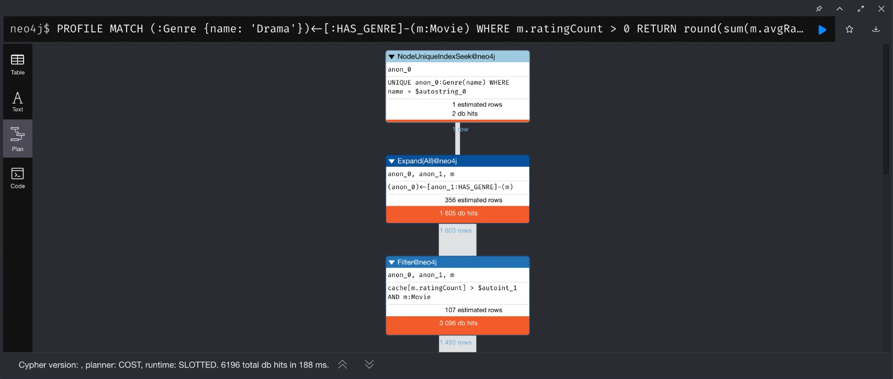

Результат того самого запиту без `PROFILE`:

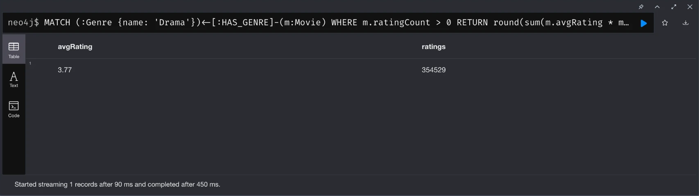

Результат той самий — 3.77 і 354 529 оцінок, але замість 1 071 200 db hits — 6 196 (у 170 разів менше), а час — 188 ms замість 2 295 ms. Ціна — ці властивості треба оновлювати, коли з'являються нові оцінки (або перераховувати їх за розкладом). Для MovieLens, де дані не змінюються, це безкоштовно.

Що ще я б застосувала:
- **Окремий тип ребра для високих оцінок.** Neo4j групує ребра «щільних» вузлів за типом, тому якщо зберігати оцінки 4–5 як `LIKED`, запити на кшталт 3 і 5 читатимуть тільки ці ребра, а не всі `RATED`, і фільтр `rating >= 4` не доведеться перевіряти на кожному ребрі.
- **Знижувати вагу популярних фільмів у рекомендаціях.** У запиті 5 збіг на American Beauty майже нічого не каже про смак, бо цей фільм оцінили всі. Можна не враховувати фільми з дуже великою кількістю оцінок або давати їм меншу вагу.
- **Розбити великий жанр на менші вузли**, наприклад Drama за десятиліттями: `(:Genre {name: 'Drama'})<-[:PART_OF]-(:GenreDecade {decade: 1990})<-[:HAS_GENRE]-(:Movie)`. Тоді запит «драми 90-х» не перебирає всі 1 603 драми. Для цього датасету я вважаю це зайвим ускладненням: 1 603 ребра Neo4j обходить швидко, повільним запит робить не сам жанр, а оцінки за ним, і це вирішують агрегати.

## Частина 5 — Графові алгоритми GDS

Необов'язкова частина, я її не виконувала.

## Частина 6 — Аналіз і висновки

Щоб порівнювати не на словах, я завантажила ті самі CSV у SQLite і виконала SQL-версії запитів 5 і 4 (`sql_compare.py`). Схема — три таблиці: `movies`, `movie_genres`, `ratings` з первинним ключем `(user_id, movie_id)` та індексом на `movie_id`.

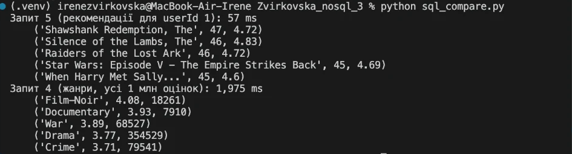

**1. Граф vs SQL. Які запити частини 3 було б складно або неможливо написати в SQL?**

Найскладніший для SQL — запит 6, найкоротший шлях. У Cypher це один рядок `shortestPath((a)-[:RATED*..10]-(b))`. У SQL немає поняття «шлях», тому його довелося б будувати рекурсивним запитом, наприклад у PostgreSQL:

```sql
WITH RECURSIVE path(user_id, depth, visited) AS (
    SELECT 1, 0, ARRAY[1]                             -- старт: користувач 1
  UNION ALL
    SELECT r2.user_id, p.depth + 1, p.visited || r2.user_id
    FROM path p
    JOIN ratings r1 ON r1.user_id = p.user_id         -- фільми поточного користувача
    JOIN ratings r2 ON r2.movie_id = r1.movie_id      -- інші глядачі цих фільмів
    WHERE r2.user_id <> ALL(p.visited) AND p.depth < 2
)
SELECT MIN(depth) * 2 AS path_length FROM path WHERE user_id = 46;
```

Кожен крок — це JOIN таблиці `ratings` саму з собою двічі, а захист від ходіння по колу (`visited`) доводиться писати вручну. Головна проблема в тому, що рекурсія в SQL не має спільного списку вже відвіданих вузлів, як пошук у ширину в Neo4j: кожна гілка йде окремо. Вже на першому кроці з користувача 1 виходить 60 146 рядків (5 899 різних користувачів — майже всі, бо через популярні фільми кожен «бачить» майже всіх, частина 4), а на другому кроці кожен з цих рядків знову множиться на сотні оцінок і тисячі глядачів — це мільярди рядків. Крім того, цей запит повертає лише довжину, а щоб показати сам ланцюжок «User 1 → Cinderella → User 536 → …», треба ще окремо збирати масив фільмів. Тобто запит 6 у SQL написати можна, але він довгий, крихкий і на цих даних дуже важкий.

Запит 5 (рекомендації) у SQL — це кілька з'єднань однієї таблиці `ratings` із собою: CTE «мої улюблені фільми» → CTE «50 схожих користувачів» → їхні фільми, яких немає в мене (`NOT EXISTS`). Він працює (`sql_compare.py`), але читати його складніше: у Cypher той самий запит виглядає як шлях «я → фільм ← інша людина → її фільм», а в SQL цей шлях розкладений на три JOIN-и і два підзапити.

Чесний висновок з мого порівняння: на 1 млн оцінок SQLite з правильними індексами виконує запит 5 навіть швидше, ніж Neo4j Browser (57 ms проти ~1,8 с). Тобто для двох кроків від одного користувача граф не дає виграшу у швидкості, тільки в читабельності. Перевага графа з'являється, коли глибина шляху невідома заздалегідь (запит 6) або кроків стає більше: кожен додатковий крок у SQL — ще один JOIN, а в Cypher — просто довший шаблон.

**2. Де граф програє?**

Граф програє на задачах, де треба пройти всі дані, а не йти по зв'язках від конкретного вузла. Запит 4 (середній рейтинг по жанрах) зачіпає всі 1 млн оцінок: у Neo4j він ішов 5,2 с, а в SQLite — 2,0 с, бо реляційна база робить це одним `JOIN ... GROUP BY` послідовно по таблиці, де всі оцінки лежать підряд, а Neo4j переходить по ребрах від вузла до вузла. Так само повільний у Neo4j підрахунок ступенів усіх вузлів у частині 4 (3,1 с).

Для цього датасету реляційна модель підійшла б краще для:
- **звітів і статистики** — розподіл оцінок, кількість оцінок за місяцями, середні по віку чи професії. Це класичні `GROUP BY`, а BI-інструменти і Excel працюють саме з SQL;
- **експорту даних** — з таблиці це один `SELECT` або `COPY` у CSV, а з графа ребра доводиться знову розгортати в рядки;
- **перевірки якості даних** — у SQL я можу задати `CHECK (rating BETWEEN 1 AND 5)` і `NOT NULL`, а в Neo4j Community є лише обмеження унікальності (обмеження на існування і тип властивості — тільки в Enterprise). Тому всі перевірки даних я робила окремим скриптом `check_data.py`;
- **масового завантаження** — у Neo4j мені знадобився APOC і батчі, щоб не впасти по пам'яті, а в SQL мільйон рядків завантажується звичайним `COPY`.

**3. Покращення схеми. Які зміни прискорили б конкретні запити з частини 3?**

- **Запити 1 і 4 — попередньо пораховані агрегати.** Я вже перевірила це в частині 4: властивості `avgRating` і `ratingCount` на вузлі `Movie` зменшили запит по жанру Drama з 1 071 200 до 6 196 db hits. Запит 1 тоді виглядав би як `MATCH (:Genre {name: 'Thriller'})<-[:HAS_GENRE]-(m) WHERE m.avgRating > 4.0` і проходив би лише 492 фільми, без жодного ребра `RATED`. Мінус — агрегати треба оновлювати при кожній новій оцінці.
- **Запити 3 і 5 — окремий тип ребра `LIKED` для оцінок 4–5.** Обидва запити фільтрують `rating >= 4`, і зараз Neo4j читає кожне ребро `RATED`, щоб перевірити оцінку. Neo4j зберігає ребра щільних вузлів згрупованими за типом, тому з `LIKED` запит читатиме лише потрібні ребра (а це 57% усіх оцінок). Мінус — при зміні оцінки ребро доведеться перетворювати з одного типу на інший.
- **Запит 5 — збережені ребра схожості `SIMILAR` між користувачами.** Зараз «схожі користувачі» шукаються під час кожного запиту, через тисячі оцінок. Якщо один раз (наприклад, щоночі) порахувати для кожного користувача 50 найсхожіших і зберегти як ребра `(:User)-[:SIMILAR {score}]->(:User)`, рекомендація стане коротким шляхом: я → схожі → їхні улюблені фільми. Так працюють реальні рекомендаційні системи, і саме це робить крок 1 у частині 5 з GDS. Заодно схожість можна рахувати точніше (нормалізувати на кількість оцінок), щоб не всі рекомендації були блокбастерами.
- **Запит 2 — лічильник п'ятірок на вузлі `User`** (`fiveCount`). Тоді запит — це просто фільтр по 6 040 вузлах замість перебору 226 тис. ребер з оцінкою 5.

**Мій загальний висновок.** Граф виграє, коли питання звучить як «хто пов'язаний з ким і через що»: рекомендації, спільні фільми, ланцюжки між людьми. Такі запити в Cypher коротші й зрозуміліші. Але граф не робить автоматично швидшим усе підряд: на 1 млн оцінок SQL так само швидко робить два кроки від користувача і швидше рахує статистику по всіх даних. А супервузли (популярні фільми, великі жанри) роблять запити через себе дорогими, і це треба враховувати ще на етапі проєктування схеми.

Тому мені найбільше подобається думка, що не треба обирати одну базу на все. У реальному проєкті їх можна поєднувати і давати кожній ту частину роботи, яку вона робить найкраще. Для MovieLens я бачу це так: оцінки, користувачі і фільми зберігаються в реляційній базі — там зручно перевіряти дані, будувати звіти і робити експорт. А граф будується з тих самих даних і відповідає за рекомендації, пошук схожих людей і ланцюжки зв'язків. Якщо додати сюди векторний пошук з ДЗ 2, можна шукати фільми за описом сюжету, а граф уже підкаже, хто з людей зі схожим смаком їх дивився. Такий підхід називається polyglot persistence. Мінус у тому, що дані тоді живуть у кількох місцях, і їх треба синхронізувати, але для кожної задачі ти береш інструмент, який під неї створений.
